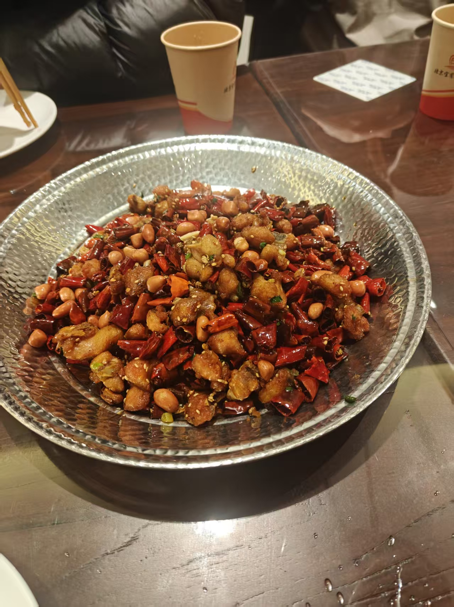
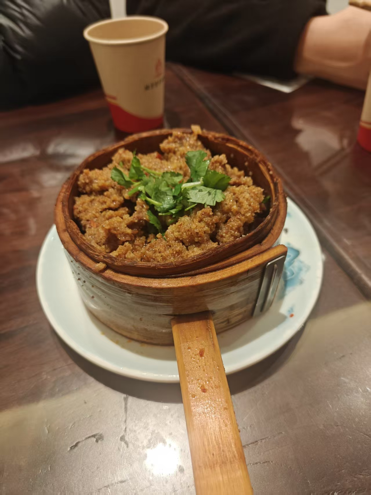
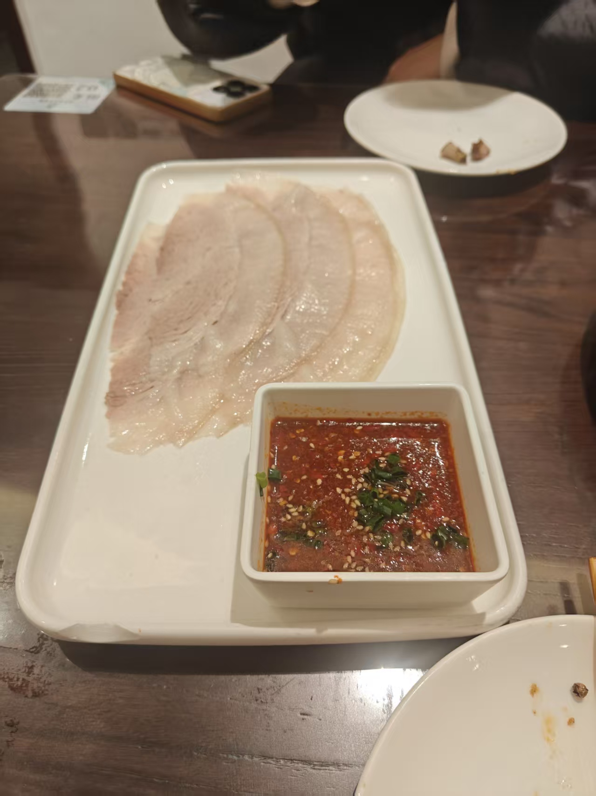
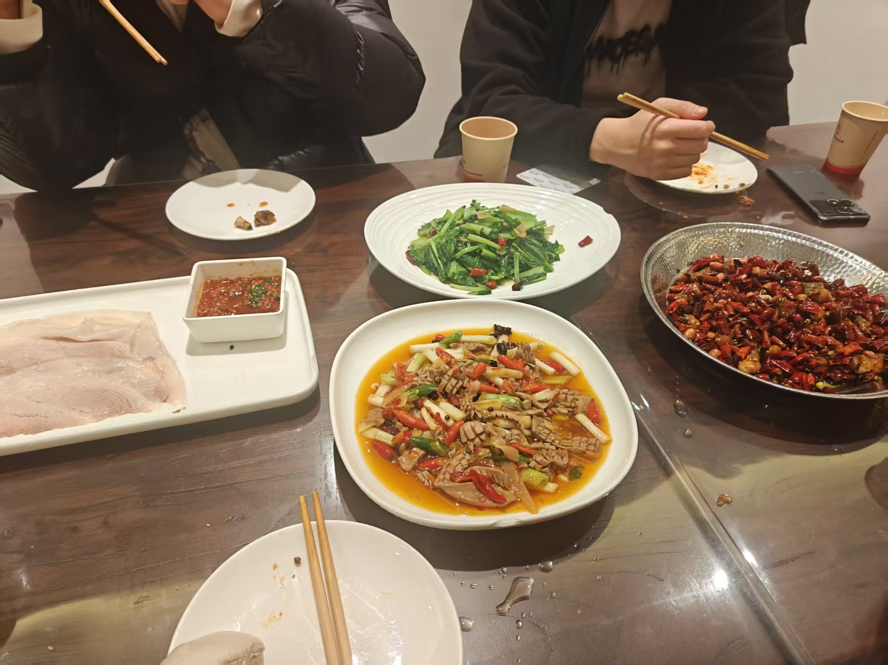
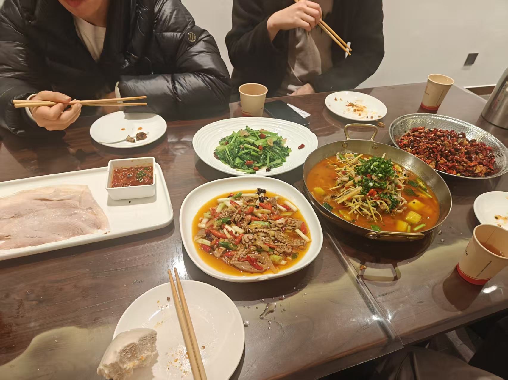
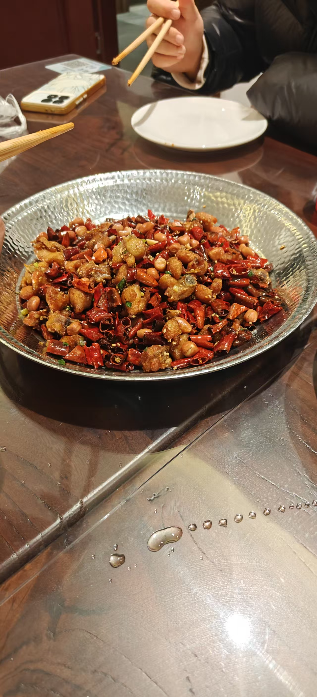
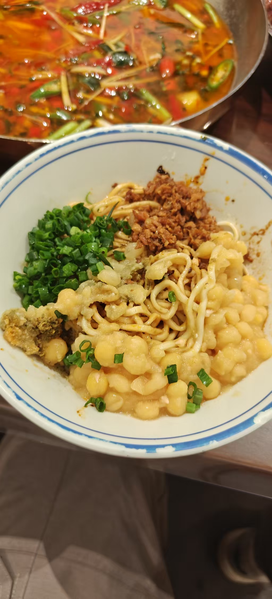
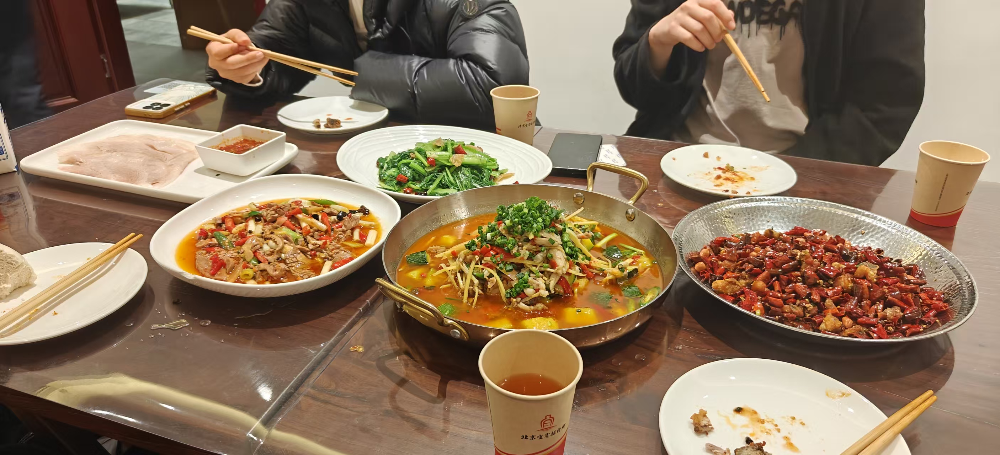

<!-- 将照片复制到当前文件夹，设置 cover 为封面文件名，并填写标题、摘要和图片描述。 -->
<!-- cover 留空时，使用当前文件夹中按文件名排序的第一张图片。 -->

在宜宾招待所吃到的这桌川菜，端上来时就很有气势，香味先一步扑过来，入口是鲜、香、麻、辣层层铺开，够过瘾，却也让人忍不住一筷接一筷。六个菜肴六种辣味，舌尖的麻辣鲜香终于是把我的味蕾激活，不再只有咸甜。

比起一道菜单独出彩，我更喜欢大家围着一桌慢慢分享的感觉。边吃边聊，热菜一盘盘转过来，辣意在嘴里散开，席间也跟着热闹起来。这顿饭让我体验到了宜宾的烟火气：爽快、浓郁，带着川菜特有的鲜活劲儿。

<!-- 在下方添加照片，例如： -->
<!-- 每张照片都需要在正文中用 Markdown 引用，才会出现在完整图文中。 -->
